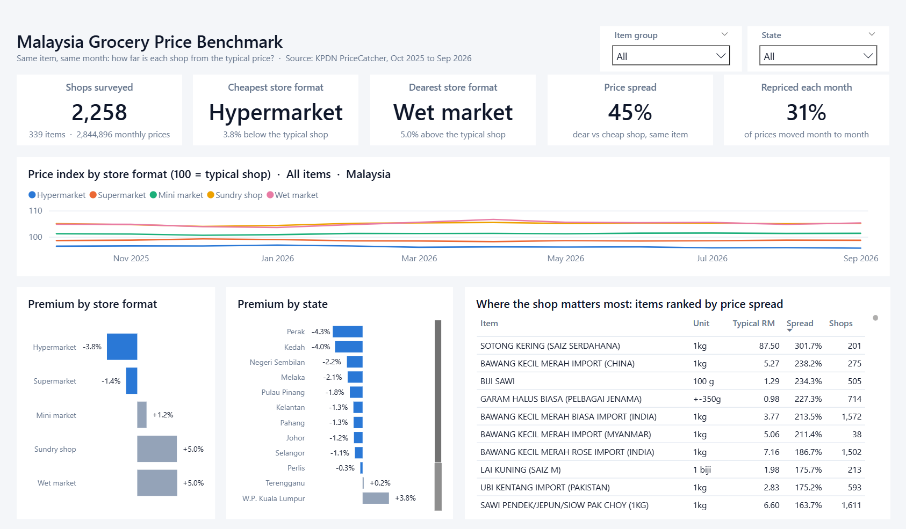
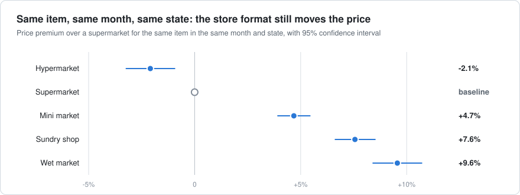
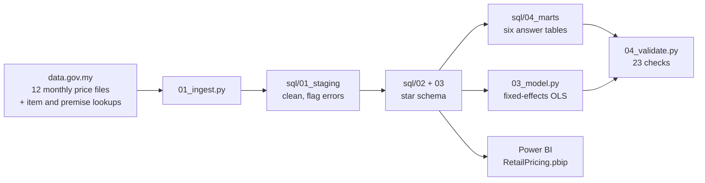

# PriceCatcher Retail Pricing

**The same bag of onions, in the same month. How much does the price depend on the shop you walk into?**



Malaysia's Ministry of Domestic Trade and Cost of Living (KPDN) sends price monitors into
shops every day and publishes what they record as
[PriceCatcher](https://data.gov.my/data-catalogue/pricecatcher). This project takes twelve
months of it, **20.7 million daily price records from 2,258 shops**, builds a star schema in
SQL, and uses it for the kind of work a retail pricing team does: benchmarking store formats
like for like, measuring price spread by item, costing a fixed basket, and finding out who
actually changes their prices.

Built with **SQL (DuckDB)**, **Power BI (star schema, 33 DAX measures)** and **Python
(statsmodels)** for the fixed-effects model.

## What the data said

<picture>
  <source media="(prefers-color-scheme: dark)" srcset="assets/format-premium-dark.svg">
  
</picture>

| The question | What the data said | Where |
|---|---|---|
| Is one store format cheaper for the same item? | Yes. Against a supermarket in the same state, a hypermarket is **2.1% cheaper**, a mini market 4.7% dearer, a sundry shop 7.6% dearer and a wet market 9.6% dearer. Every interval excludes zero. | [`model_coefficients.csv`](data/processed/model_coefficients.csv) |
| So does knowing the format tell you the price? | Barely. Format and state together explain **6.3%** of the price differences for the same item in the same month. The individual shop adds 12.6%. The remaining **81.1%** is the same shop being cheap on one item and dear on another. | [`model_variance.csv`](data/processed/model_variance.csv) |
| What does that mean in ringgit? | A fixed basket of 16 staples costs **RM110.96** at hypermarket prices and **RM126.58** at wet market prices: RM15.62, or 14%, for the same list. | [`mart_basket.csv`](data/processed/mart_basket.csv) |
| Which items have one price everywhere? | Sugar and 1 kg packet cooking oil show a **0.0%** spread between a dear shop and a cheap one. Both are price-controlled, and the control shows up in the data. Onions and loose vegetables spread by 150% to 240%. | [`mart_item_dispersion.csv`](data/processed/mart_item_dispersion.csv) |
| Who changes prices? | For packaged food, **25.7%** of hypermarket prices move from one month to the next, against **5.2%** in sundry shops. Cuts and rises are roughly even, which is what promotions look like. | [`mart_repricing.csv`](data/processed/mart_repricing.csv) |
| Where is it cheapest? | Perak and Kedah, about 4% below the typical shop. Sabah, Sarawak, Labuan and Putrajaya sit 5% to 6% above it. | [`mart_state_index.csv`](data/processed/mart_state_index.csv) |

The second row is the one I would take to a pricing meeting. The format gap is real and
measurable, but a shopper who picks the "cheap format" and stops there has captured very
little of what is available, and a retailer whose price image rests on its format has the
same problem in reverse.

## How the comparison is made

Comparing average prices across shops would mostly measure what they stock. A wet market
sells fish and a mini market sells instant noodles. Every comparison here is therefore made
**within the same item and the same month**:

1. Daily records are collapsed to each shop's **median price per item per month**, because
   shops are surveyed on different days and a different number of times.
2. Each price is expressed as a **log gap to the benchmark**, the geometric mean across all
   shops pricing that item that month. Averaging log gaps means a RM35 bag of rice cannot
   outweigh a RM3 bag of flour.
3. A **price index** is the exponent of the average gap, times 100. An index of 96.2 means
   3.8% below the typical shop on a like-for-like basis.

The index and the model answer slightly different questions, which is why hypermarkets are
3.8% below *the typical shop* on the dashboard and 2.1% below *a supermarket in the same
state* in the model. The model also separates format from location, which matters because
formats are not spread evenly: Kuala Lumpur is mostly supermarkets, while sundry shops are the largest group in
Terengganu.

```
log(price) = item-by-month effect + store format + state + error
```

2,844,896 observations, 3,940 item-month fixed effects absorbed by demeaning, standard
errors clustered on 2,258 shops. The variance split replaces format and state with one
fixed effect per shop and solves the two-way model by alternating projections.

## Pipeline



```bat
run_pipeline.bat        (Windows)
./run_pipeline.sh       (Git Bash / Linux / macOS)
```

First-time setup, if `.venv` does not exist yet:

```bash
python -m venv .venv
.venv\Scripts\python.exe -m pip install -r requirements.txt
```

| Step | Script | What it does |
|---|---|---|
| 1 | `scripts/01_ingest.py` | Downloads the lookups and twelve monthly files to `data/raw/`, with retries and column checks. Closed months already on disk are skipped. |
| 2 | `scripts/02_build_warehouse.py` | Runs `sql/01` to `sql/05` in order against DuckDB and exports the tables to `data/processed/`. |
| 3 | `scripts/03_model.py` | Fits the fixed-effects model and the variance split. |
| 4 | `scripts/04_validate.py` | 23 checks on keys, referential integrity, measures and reconciliation. Exits non-zero if any fail. |
| 5 | `scripts/05_build_chart.py` | Draws the chart above from the model output, as light and dark SVG. |

The whole run takes about a minute after the first download.

## The SQL

All transformation logic is in five SQL files, run in order.

| File | Builds | Worth a look for |
|---|---|---|
| [`sql/01_staging.sql`](sql/01_staging.sql) | `stg_item`, `stg_premise`, `stg_price` | Window median per item-month to flag keying errors |
| [`sql/02_dimensions.sql`](sql/02_dimensions.sql) | `dim_item`, `dim_premise`, `dim_month` | Conformed dimensions with English labels and sort keys |
| [`sql/03_fact.sql`](sql/03_fact.sql) | `fact_price_monthly` | Two named windows: the like-for-like benchmark and a gap-safe `LAG` |
| [`sql/04_marts.sql`](sql/04_marts.sql) | Six marts | `GROUPING SETS`, `FILTER` aggregates, percentiles, `RANK`, a basket built with semi joins |
| [`sql/05_quality.sql`](sql/05_quality.sql) | `quality_audit` | An audit trail that has to add up |

**Star schema.** `fact_price_monthly` has one row per shop, item and month (2,844,896 rows)
and joins to `dim_premise` (2,258 shops), `dim_item` (339 items) and `dim_month` (12 months).

## The Power BI report

Open `powerbi/RetailPricing.pbip` in Power BI Desktop and click **Refresh**. The model
reads the parquet files in the folder named by the `ProcessedFolder` parameter; if the
project lives somewhere else on your machine, change it under **Transform data > Edit
parameters**.

- **Three tiers on one page:** five KPI tiles, the monthly index by format, then ranked
  bars and the item table for detail.
- **33 DAX measures** in display folders: base counts, benchmark (index, premium, P90/P10
  spread), repricing, format ranking, card text and dynamic titles.
- **Slicers** for item group and state. The benchmark stays national when a state is
  selected, so the bars read as "this state against the country".
- Bars are blue where prices sit below the typical shop and grey where they sit above it.

## What the raw data needed

| Step | Rows |
|---|---:|
| Daily price rows downloaded | 20,687,140 |
| Removed: item code missing from the item lookup | 306,987 |
| Removed: keying errors, more than 3x from the monthly median for the item | 40,664 |
| Removed: wholesale premises | 369 |
| **Daily rows kept** | **20,339,120** |

- **Keying errors are real and obvious.** A kilo of Indian onions recorded at RM5,390
  against a median of RM5.90 is a misplaced decimal point, and there are RM0.01
  placeholders. They are 0.2% of rows.
- **`'Pasar Basah '` has a trailing space** in part of the premise lookup, which silently
  splits wet markets into two store formats unless it is trimmed.
- **Seventeen item codes are priced but not described.** They carry 1.5% of rows and are
  dropped rather than guessed at.
- **The lookup lists restaurants and food courts** that have no grocery prices in these
  files. Only the five retail formats with prices are kept.

## What this does not show

- **PriceCatcher is a monitoring programme, not a random sample.** KPDN chooses the shops
  and the items. The results describe the shops surveyed.
- **The same item code is not always the same product.** For branded packaged goods it is.
  For fish and vegetables, a wet market's premium may be partly freshness or grade, which
  the data cannot see.
- **There are no sales volumes.** Every item counts equally in the index, so this is a
  price comparison and not a cost-of-living measure.
- **September 2026 is partial.** The published file ends on 24 September.
- **Twelve months is one cycle.** It is enough to compare shops with each other and not
  enough to say anything about seasonality.

## Source

PriceCatcher, Kementerian Perdagangan Dalam Negeri dan Kos Sara Hidup (KPDN), published by
the Department of Statistics Malaysia on [data.gov.my](https://data.gov.my/data-catalogue/pricecatcher)
under CC BY 4.0. Window used: 1 October 2025 to 24 September 2026.
